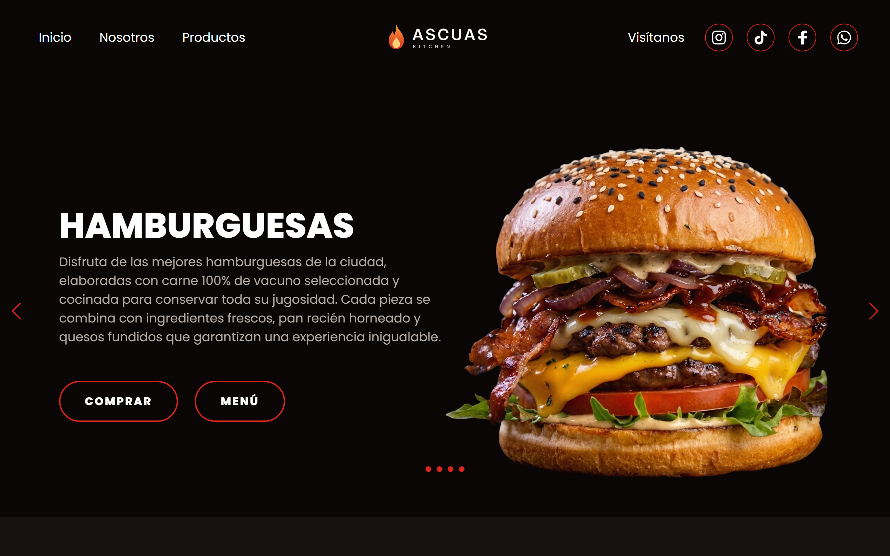
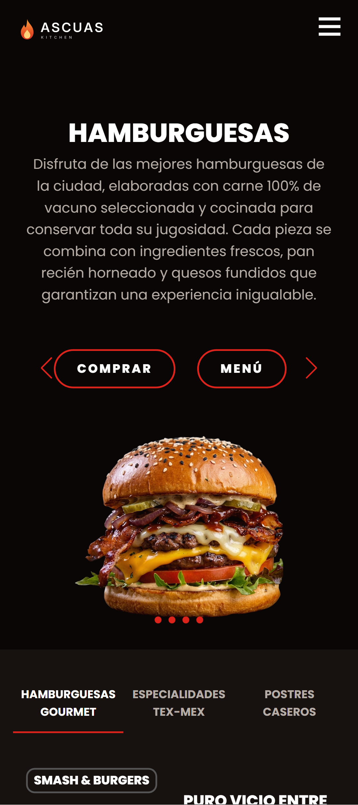

## 🔥 Ascuas Kitchen

Web de una hamburguesería ficticia con hamburguesas gourmet, especialidades Tex-Mex y postres caseros. Es un **proyecto de práctica** hecho con HTML, CSS y JavaScript, sin frameworks.

> Los datos, las reseñas, los teléfonos y los enlaces son ficticios.

🌐 **Demo:** https://WebsByJimenez.github.io/ascuas-kitchen/

|                                  Versión Escritorio                                   |                                Versión Móvil                                |
| :-----------------------------------------------------------------------------------: | :-------------------------------------------------------------------------: |
|  |  |

[](https://developer.mozilla.org/es/docs/Web/HTML)
[](https://developer.mozilla.org/es/docs/Web/CSS)
[](https://developer.mozilla.org/es/docs/Web/JavaScript)
[](https://swiperjs.com/)

## ✨ Características

- Diseño adaptable (responsive) para ordenador, tablet y móvil.
- Slider principal y sliders de productos con [Swiper](https://swiperjs.com/).
- Carta con tres pestañas (hamburguesas, Tex-Mex y postres) hechas solo con CSS.
- Menú hamburguesa en móvil que se cierra al pulsar un enlace.
- Cuadro de reseña con valoración por estrellas, que simula el envío sin guardar nada.
- Avisos flotantes en los botones de ejemplo (Comprar, Menú, Más información y Cómo llegar).
- Accesibilidad: textos alternativos en las imágenes, etiquetas `aria-label` y pestañas y estrellas manejables con teclado.
- SEO básico: `meta description` y etiquetas Open Graph para compartir el enlace.

## 💻 Tecnologías

- HTML5
- CSS3 (variables, Flexbox, Grid y `@media`)
- JavaScript (vanilla)
- Swiper 11
- Tipografía Poppins, alojada en local (carpeta `fonts/`)

## 📂 Estructura del proyecto

```text
ascuas-kitchen/
├── index.html
├── .gitignore
├── LICENSE
├── README.md
├── css/
│   └── estilos.css
├── doc/
│   ├── captura-escritorio.png
│   └── captura-movil.png
├── fonts/
│   ├── poppins-v24-latin-regular.woff2
│   ├── poppins-v24-latin-600.woff2
│   ├── poppins-v24-latin-700.woff2
│   └── poppins-v24-latin-800.woff2
├── js/
│   └── main.js
└── img/
    ├── chuletas.png
    ├── fachada.png
    ├── fajita.png
    ├── food1.png
    ├── food2.png
    ├── food3.png
    ├── food4.png
    ├── menu.png
    ├── og-image.jpg
    ├── postre1.png
    ├── postre2.png
    ├── postre3.png
    ├── slider1.png
    ├── slider2.png
    ├── slider3.png
    ├── slider4.png
    ├── facebook.svg
    ├── favicon.svg
    ├── instagram.svg
    ├── logo.svg
    ├── tiktok.svg
    └── whatsapp.svg
```

## ▶️ Cómo ejecutarlo en local

1. Descarga o clona el repositorio.
2. Abre `index.html` en el navegador.

No necesita instalación ni servidor. Hace falta conexión a internet solo para cargar Swiper; la tipografía Poppins está incluida en el proyecto.

## ⭐ Créditos de imágenes

Todas las imágenes del proyecto (fotos de la carta, fachada y demás) están generadas con inteligencia artificial y se incluyen solo con fines ilustrativos.

## 🔤 Créditos de tipografía

La tipografía [Poppins](https://fonts.google.com/specimen/Poppins) se distribuye bajo la licencia [SIL Open Font License 1.1](https://openfontlicense.org/) y se incluye en la carpeta `fonts/`.

## ⚖️ Licencia

Código bajo licencia MIT: puedes usarlo, copiarlo y modificarlo siempre que mantengas el aviso de copyright. Consulta el archivo [LICENSE](LICENSE).

## 👤 Autor

**WebsByJiménez** · [GitHub](https://github.com/WebsByJimenez)
