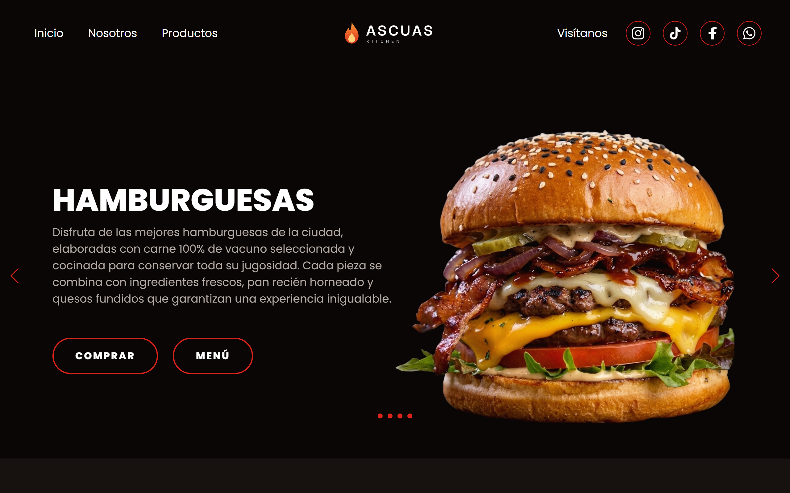

## 🔥 Ascuas Kitchen

Web de una hamburguesería ficticia con hamburguesas gourmet, especialidades Tex-Mex y postres caseros. Es un **proyecto de práctica** hecho con HTML, CSS y JavaScript, sin frameworks.

> Los datos, las reseñas, los teléfonos y los enlaces son ficticios.

**Demo:** https://WebsByJimenez.github.io/ascuas-kitchen/



[](https://developer.mozilla.org/es/docs/Web/HTML)
[](https://developer.mozilla.org/es/docs/Web/CSS)
[](https://developer.mozilla.org/es/docs/Web/JavaScript)

## ✨ Características

- Diseño adaptable (responsive) para ordenador, tablet y móvil.

- Slider principal y sliders de productos con [Swiper](https://swiperjs.com/).
- Carta con tres pestañas (hamburguesas, Tex-Mex y postres) hechas solo con CSS.
- Menú hamburguesa en móvil que se cierra al pulsar un enlace.
- Cuadro de reseña con valoración por estrellas, que simula el envío sin guardar nada.
- Avisos flotantes en los botones de ejemplo (Comprar, Menú, Más información y Cómo llegar).
- Accesibilidad: textos alternativos en las imágenes, etiquetas `aria-label` y pestañas y estrellas manejables con teclado.
- SEO básico: `meta description` y etiquetas Open Graph para compartir el enlace.

## 💻 Tecnologías

- HTML5
- CSS3 (variables, Flexbox, Grid y `@media`)
- JavaScript (vanilla)
- Swiper 11
- Tipografía Poppins (Google Fonts)

📂 Estructura del Proyecto

```bash

ascuas-kitchen/
├── index.html
├── .gitignore
├── LICENSE
├── README.md
├── css/
│   └── estilos.css
├── doc/
│   └── captura-escritorio.png
├── js/
│   └── main.js
└── img/
├── chuletas.png
├── fachada.png
├── fajita.png
├── food1.png
├── food2.png
├── food3.png
├── food4.png
├── menu.png
├── og-image.jpg
├── postre1.png
├── postre2.png
├── postre3.png
├── slider1.png
├── slider2.png
├── slider3.png
├── slider4.png
├── facebook.svg
├── instagram.svg
├── logo.svg
├── tiktok.svg
└── whatsapp.svg
```

## ▶️ Cómo ejecutarlo en local

1. - Descarga o clona el repositorio.
2. - Abre `index.html` en el navegador.

No necesita instalación ni servidor. Hace falta conexión a internet para cargar Swiper y la tipografía.

## ⭐ Créditos de imágenes

Todas las imágenes del proyecto (fotos de la carta, fachada y demás) están generadas con inteligencia artificial y se incluyen solo con fines ilustrativos.

## ⚖️ Licencia

Código bajo licencia MIT: puedes usarlo, copiarlo y modificarlo siempre que mantengas el aviso de copyright. Consulta el archivo [LICENSE](LICENSE).

## 👤 Autor

**WebsByJiménez** · [GitHub](https://github.com/WebsByJimenez)
